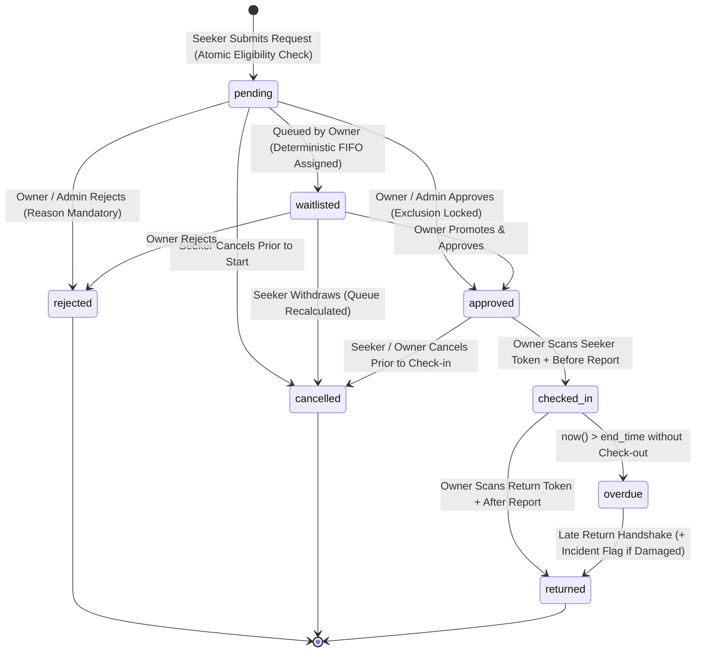

# ResourceLoop Frontend Integration & Service Layer Contract

This document provides frontend engineers with data contracts, exported backend services, query patterns, workflow state transitions, and Supabase client examples for ResourceLoop.

---

## 1. Service Layer Architecture

The backend exposes a modular service layer under `src/services/` that interacts with Supabase while enforcing data validation, Row Level Security (RLS), and business logic.

### 1.1 Resource Management Service (`src/services/resources.ts`)

```typescript
import {
  listResources,
  getResourceById,
  createResource,
  updateResource,
  deleteResource,
  getOwnerResources,
  getAvailableResources,
  uploadResourceImage,
  checkResourceEligibility,
  getResourceAvailability,
} from '../services/resources';
```

#### Function Specifications:

| Function | Parameters | Return Type | Description |
| :--- | :--- | :--- | :--- |
| **`listResources`** | `filters?: ResourceFilters` | `Promise<Resource[]>` | Search and filter resources with joins to `organization` and `owner`. |
| **`getResourceById`** | `id: string` | `Promise<Resource \| null>` | Retrieve resource details by UUID. |
| **`createResource`** | `input: CreateResourceDTO` | `Promise<Resource>` | Register new institutional asset (restricted to authorized owners/admins). |
| **`updateResource`** | `id: string, input: UpdateResourceDTO` | `Promise<Resource>` | Update resource specifications (restricted to asset owner/admin). |
| **`deleteResource`** | `id: string` | `Promise<void>` | Delete resource (restricted to asset owner/admin). |
| **`getOwnerResources`** | `ownerId?: string` | `Promise<Resource[]>` | Retrieve all resources managed by owner (defaults to authenticated user). |
| **`getAvailableResources`**| *none* | `Promise<Resource[]>` | Quick helper returning all resources with `status = 'available'`. |
| **`uploadResourceImage`**| `file: File, organizationId: string` | `Promise<string>` | Upload image to `resource-images` bucket and return public URL. |
| **`checkResourceEligibility`**| `resourceId: string, userId?: string` | `Promise<ResourceEligibilityResult>` | Reusable check for operational status, training, and affiliation. |
| **`getResourceAvailability`**| `resourceId: string` | `Promise<ResourceAvailabilityInfo>` | Retrieve operating days, hours, and booking slot duration. |

---

### 1.2 Profile Service (`src/services/profiles.ts`)

```typescript
import {
  getCurrentProfile,
  getProfileById,
  updateCurrentProfile,
} from '../services/profiles';
```

#### Function Specifications:

| Function | Parameters | Return Type | Description |
| :--- | :--- | :--- | :--- |
| **`getCurrentProfile`** | *none* | `Promise<Profile \| null>` | Get authenticated user's profile with linked organization. |
| **`getProfileById`** | `userId: string` | `Promise<Profile \| null>` | Lookup profile by user ID. |
| **`updateCurrentProfile`** | `input: UpdateProfileDTO` | `Promise<Profile>` | Update display name, avatar, or org. **Role escalation is blocked**. |

---

### 1.3 Organization Service (`src/services/organizations.ts`)

```typescript
import {
  getOrganizations,
  getOrganizationById,
} from '../services/organizations';
```

#### Function Specifications:

| Function | Parameters | Return Type | Description |
| :--- | :--- | :--- | :--- |
| **`getOrganizations`** | *none* | `Promise<Organization[]>` | Retrieve verified universities, research labs, and institutes. |
| **`getOrganizationById`** | `id: string` | `Promise<Organization \| null>` | Lookup organization details by UUID. |

---

### 1.4 Booking & Allocation Service (`src/services/bookings.ts`)

```typescript
import {
  requestBooking,
  approveBooking,
  rejectBooking,
  waitlistBooking,
  cancelBooking,
  generateBookingPass,
  verifyCheckIn,
  verifyCheckOut,
  markOverdueBookings,
  getBookingById,
  fetchUserBookings,
  fetchOwnerBookings,
  getBookingTimeline,
} from '../services/bookings';
```

#### Function Specifications:

| Function | Parameters | Return Type | Description |
| :--- | :--- | :--- | :--- |
| **`requestBooking`** | `dto: CreateBookingDTO` | `Promise<Booking>` | **Exclusive client creation path**. Direct INSERT is revoked. Atomically validates eligibility, organization verification, availability, and usage limits (including overdue), then creates pending reservation. |
| **`approveBooking`** | `bookingId: string` | `Promise<Booking>` | Approves booking; acquires shared resource lock, enforces precise overdue custody rule (blocks sessions starting within 24h if equipment is overdue), and enforces GiST scheduled overlap constraint. |
| **`rejectBooking`** | `bookingId: string, rejectionReason: string` | `Promise<Booking>` | Rejects booking with mandatory explanation; recalculates waitlist. |
| **`waitlistBooking`**| `bookingId: string` | `Promise<Booking>` | Moves request to deterministic FIFO waitlist with unique queue position. |
| **`cancelBooking`** | `bookingId: string` | `Promise<Booking>` | Cancels reservation prior to check-in (seeker or owner/admin); recalculates waitlist. |
| **`generateBookingPass`** | `bookingId: string, tokenType: 'check_in' \| 'check_out'` | `Promise<BookingPassResponse>` | STRICT: Restricted to booking's seeker. Generates opaque 256-bit single-use pass for screen display; stores only SHA-256 hash. |
| **`verifyCheckIn`** | `dto: VerifyHandshakeDTO` | `Promise<Booking>` | Custodian scans pass; atomically logs `before` condition report and marks asset `checked_in`. |
| **`verifyCheckOut`**| `dto: VerifyHandshakeDTO` | `Promise<Booking>` | Custodian scans return pass; atomically logs `after` condition report and transitions to `returned`. Auto-flags incident if damaged. |
| **`markOverdueBookings`** | *none* | `Promise<number>` | Maintenance sweep: transitions checked_in bookings past end_time to `overdue` while retaining active custody protection. |
| **`getBookingById`** | `id: string` | `Promise<Booking \| null>` | Retrieves booking with full joins (resource, org, profiles, condition reports, incidents). |
| **`fetchUserBookings`**| `userId?: string` | `Promise<Booking[]>` | Retrieves reservations submitted by seeker (defaults to authenticated user). |
| **`fetchOwnerBookings`**| `ownerId?: string` | `Promise<Booking[]>` | Retrieves all booking requests for assets managed by owner. |
| **`getBookingTimeline`**| `bookingId: string` | `Promise<{ booking, conditionReports, incidents, auditLogs }>` | Complete audit and condition timeline for compliance and dispute resolution. |

---

## 2. Usage Examples in React Components

### 2.1 Fetching Resources with Filters (Catalogue / Discovery)

```typescript
import { useState, useEffect } from 'react';
import { listResources } from '@/services/resources';
import type { Resource, ResourceFilters } from '@/types/domain';

export function useResourceCatalogue(filters: ResourceFilters) {
  const [resources, setResources] = useState<Resource[]>([]);
  const [loading, setLoading] = useState(true);
  const [error, setError] = useState<string | null>(null);

  useEffect(() => {
    let isMounted = true;
    setLoading(true);

    listResources(filters)
      .then((data) => {
        if (isMounted) {
          setResources(data);
          setError(null);
        }
      })
      .catch((err) => {
        if (isMounted) setError(err.message);
      })
      .finally(() => {
        if (isMounted) setLoading(false);
      });

    return () => { isMounted = false; };
  }, [filters.query, filters.category, filters.resource_type, filters.available_only]);

  return { resources, loading, error };
}
```

### 2.2 Registering Equipment with Image Upload (Owner Flow)

```typescript
import { createResource, uploadResourceImage } from '@/services/resources';
import type { CreateResourceDTO } from '@/types/domain';

async function handleNewEquipmentSubmit(
  formData: CreateResourceDTO,
  imageFile: File | null
) {
  try {
    let imageUrl = formData.image_url;

    // 1. Upload image to Supabase Storage if selected
    if (imageFile) {
      imageUrl = await uploadResourceImage(imageFile, formData.organization_id);
    }

    // 2. Insert resource record
    const created = await createResource({
      ...formData,
      image_url: imageUrl,
    });

    console.log('Resource created successfully:', created.id);
    return created;
  } catch (err: any) {
    console.error('Failed to create resource:', err.message);
    throw err;
  }
}
```

### 2.3 Checking Eligibility Before Booking

```typescript
import { checkResourceEligibility } from '@/services/resources';

async function verifyBookingPrerequisites(resourceId: string) {
  const result = await checkResourceEligibility(resourceId);

  if (!result.eligible) {
    alert(`Cannot reserve: ${result.reasons.join(', ')}`);
    return false;
  }

  if (result.checks.trainingRequired) {
    // Show safety clearance confirmation dialog
    console.warn('Note: This resource requires verified training');
  }

  return true;
}
```

---

## 3. Storage Bucket: `resource-images`

ResourceLoop uses Supabase Storage for equipment and laboratory imagery.

- **Bucket Name:** `resource-images`
- **Access Level:** Public read access (`public: true`).
- **Upload Restrictions:**
  - Authenticated users with `role IN ('owner', 'admin')`.
  - Max file size: **5 MB**.
  - Permitted MIME types: `image/jpeg`, `image/png`, `image/webp`. (SVG and GIF are restricted for security against script injection / XSS).
- **Path Convention:** `<organization_id>/<timestamp>-<random_key>.<ext>`
- **Deletions:** Restricted to the asset uploader or platform administrators.

---

## 4. Booking Lifecycle & State Machine



### State Definitions:
1. **`pending`**: Initial state upon submission. Eligibility and usage limits verified atomically.
2. **`waitlisted`**: Queued request with deterministic FIFO queue position (`waitlist_position`).
3. **`approved`**: Reservation confirmed by owner. Protected against scheduled overlaps via PostgreSQL `btree_gist` exclusion constraint.
4. **`checked_in`**: Physical custody transferred. Verified via single-use QR handshake + mandatory pre-inspection report.
5. **`returned`**: Physical custody restored. Verified via return QR handshake + mandatory post-inspection report.
6. **`overdue`**: Session time elapsed without check-out. Active custody protection remains active—no new session can start while equipment is unreturned.
7. **`cancelled` / `rejected`**: Terminal closed states. Invalidate unused access tokens and recalculate waitlist queue.

### Waitlist Queue Semantics & Window Overlaps:
- **Interval-Aware Grouping**: Waitlists are evaluated dynamically per resource and overlapping time interval (`tstzrange(start_time, end_time, '[)') && tstzrange(cand_start, cand_end, '[)')`).
- **Cluster Isolation**: Queue positions are completely independent across non-overlapping intervals. Two requests scheduled for distinct days or non-overlapping hours each maintain their own independent position (e.g. both can hold `waitlist_position = 1`).
- **Partial Overlap Resolution**: Non-identical intervals that intersect (e.g. 10:00 - 14:00 vs 12:00 - 16:00) compete for the shared time slice; FIFO priority is determined strictly by submission order (`created_at ASC, id ASC`).
- **Transactional Serialization**: Queue additions and compaction are protected against concurrency races via advisory transaction locks (`pg_advisory_xact_lock(hashtext('waitlist:' || resource_id))`).
- **Compaction**: When an approved booking is cancelled or rejected, `recalculate_waitlist(resource_id)` re-indexes remaining waitlisted bookings in that time-window cluster sequentially (`1, 2, 3...`) using the exact same overlapping-window query.
- **Manual Promotion Policy**: Promotion from the waitlist is **strictly manual with custodian review**. Automated promotion into `approved` state is prohibited to avoid surprise confirmations and protect lab scheduling integrity. When a slot is vacated, the seeker at `waitlist_position = 1` is queued for review. The asset owner or platform administrator promotes the candidate by executing `approve_booking(booking_id)`, which atomically verifies eligibility, checks for conflicting active custody, transitions the booking to `approved`, and clears `waitlist_position` to `NULL`.

---

## 5. QR Access Token Security & Verification Flow

1. **Opaque High-Entropy Tokens**:
   - The QR code carries ONLY a 256-bit cryptographically random hex token (`crypto.randomBytes(32)`).
   - Zero metadata (no booking ID, user ID, resource ID, or timestamps) is encoded in the QR string.
2. **Database Hashing**:
   - The database stores **exclusively the SHA-256 hash** of the token in `public.booking_access_tokens`.
   - Ordinary users have zero direct `SELECT` access to `booking_access_tokens`.
3. **Physical Custodian Handshake**:
   - **Generation**: Seeker calls `generateBookingPass(bookingId, 'check_in')` when approved to display the QR pass.
   - **Scanning**: Authenticated Resource Owner / Lab Custodian scans the QR pass using their device camera.
   - **Verification**: Owner calls `verifyCheckIn({ raw_token, condition_status, condition_notes, image_url })`.
   - The server computes `sha256(raw_token)` to locate the booking record, verifies owner authorization and active timeframe, sets `used_at = now()`, inserts the `before` condition report, and marks the booking `checked_in`.
   - **Replay Protection**: Single-use enforcement guarantees any re-scan is rejected.
4. **Return & Incident Escalation**:
   - Return follows the same flow with `verifyCheckOut(...)`.
   - If `condition_status IN ('damaged', 'faulty')`, an open incident is automatically registered in `public.incidents` for administrative and custodian review. Automated penalties are prohibited; human review governs all resolution.

---

## 6. Supabase Setup & Demo Accounts

### 6.1 Applying Migration 002 (Non-destructive)
1. Open the Supabase Dashboard: **SQL Editor**.
2. Run `supabase/migrations/002_resource_management.sql`.
   - The script creates or updates the `resource-images` bucket safely via `ON CONFLICT (id) DO UPDATE`.
   - No existing storage objects or records are dropped or altered destructively.

### 6.2 Creating Real Authenticated Demo Accounts
To test all roles with real Supabase Auth:
1. Sign up users via the app's Signup Page or Supabase Auth Dashboard (**Authentication > Users > Add user**).
2. To assign an **`owner`** or **`admin`** role, run this in the Supabase **SQL Editor**:
```sql
-- Promote a user to owner and link to an institution
UPDATE public.profiles
SET role = 'owner', organization_id = '11111111-1111-1111-1111-111111111111'
WHERE email = 'user-email@institution.edu';

-- Promote a user to platform admin
UPDATE public.profiles
SET role = 'admin'
WHERE email = 'admin-email@institution.edu';
```
