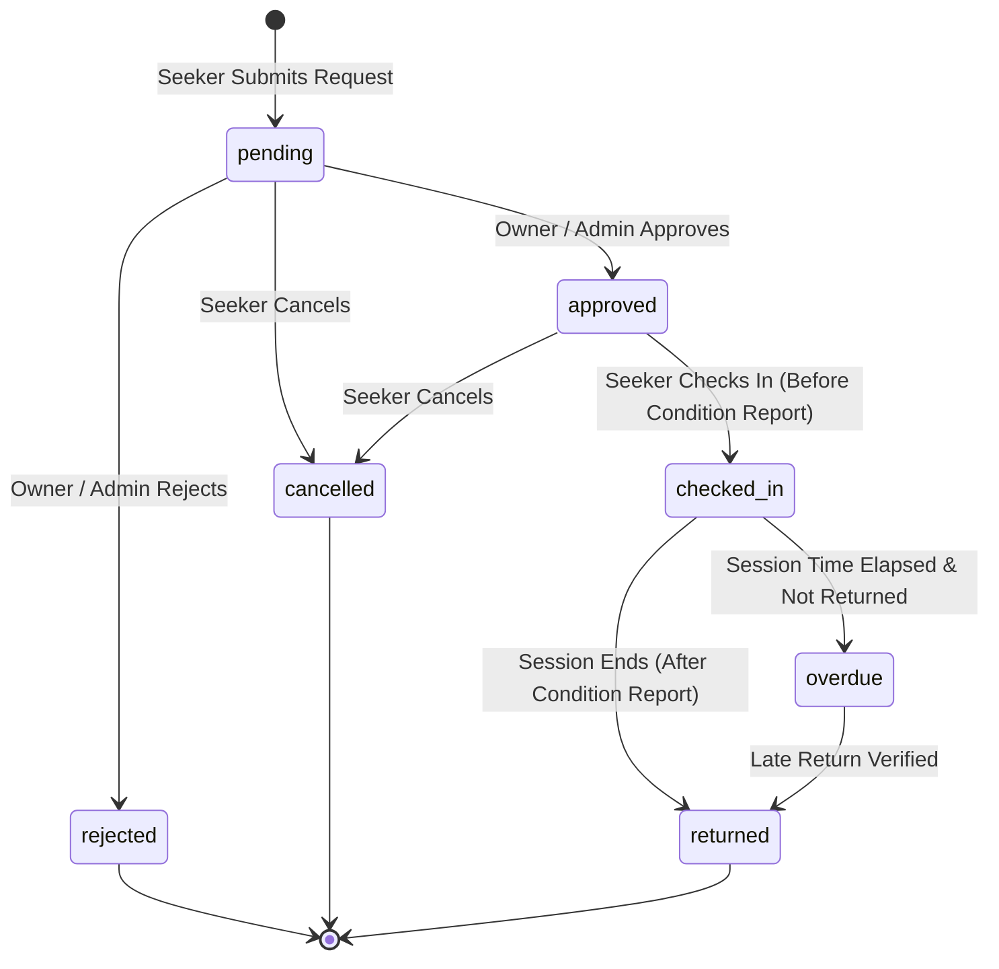

# ResourceLoop Frontend Integration & API Contract

This document provides frontend engineers with data contracts, query patterns, workflow state transitions, and Supabase client examples for ResourceLoop.

---

## 1. Environment Configuration

The frontend application requires the following environment variables (defined in `.env.local`):

```bash
VITE_SUPABASE_URL="https://<your-supabase-project-id>.supabase.co"
VITE_SUPABASE_ANON_KEY="eyJhbGciOiJIUzI1NiIsInR5cCI6IkpXVCJ9..."
```

> **CRITICAL SECURITY RULE:** Never expose or bundle the Supabase `service_role` key in frontend code. All operations are performed using the `anon` key, authenticated via JWT, and protected by PostgreSQL Row Level Security (RLS).

---

## 2. Booking Lifecycle & State Machine



### State Definitions & Rules:
1. **`pending`**: Initial state upon submission. Requesters can cancel; owners can approve or reject with an optional `rejection_reason`.
2. **`approved`**: Scheduled reservation confirmed. Requesters can submit a `before` condition report upon arrival.
3. **`checked_in`**: Asset actively in use. Unlocks the `after` condition report button.
4. **`returned`**: Asset inspected and safely returned. Terminal successful state.
5. **`overdue`**: Current time exceeds `end_time` without check-out. Flagged for institutional administrators.
6. **`cancelled` / `rejected`**: Terminal closed states.

---

## 3. Frontend Data Contracts & Queries

All domain TypeScript models are exported from [`src/types/domain.ts`](file:///Users/vinayak_sharma/Desktop/ResourceLoop/src/types/domain.ts).

### 3.1 Browsing Available Resources (with Organization Details)

```typescript
import { supabase } from '@/lib/supabaseClient';
import type { Resource } from '@/types/domain';

export async function fetchAvailableResources(): Promise<Resource[]> {
  const { data, error } = await supabase
    .from('resources')
    .select(`
      *,
      organization:organizations(*),
      owner:profiles(id, full_name, email, avatar_url)
    `)
    .neq('status', 'unavailable')
    .order('created_at', { ascending: false });

  if (error) {
    console.error('Error fetching resources:', error.message);
    throw error;
  }

  return data as Resource[];
}
```

### 3.2 Submitting a Booking Request

```typescript
import { supabase } from '@/lib/supabaseClient';
import type { CreateBookingDTO, Booking } from '@/types/domain';

export async function requestBooking(dto: CreateBookingDTO): Promise<Booking> {
  const { data: { user } } = await supabase.auth.getUser();
  if (!user) throw new Error('User not authenticated');

  const { data, error } = await supabase
    .from('bookings')
    .insert({
      resource_id: dto.resource_id,
      requester_id: user.id,
      start_time: dto.start_time,
      end_time: dto.end_time,
      purpose: dto.purpose,
      status: 'pending' // Enforced by RLS
    })
    .select(`
      *,
      resource:resources(title, category, location)
    `)
    .single();

  if (error) {
    console.error('Booking creation failed:', error.message);
    throw error;
  }

  return data as Booking;
}
```

### 3.3 Approving or Rejecting a Booking (Owner Action)

```typescript
import { supabase } from '@/lib/supabaseClient';
import type { BookingStatus, Booking } from '@/types/domain';

export async function updateBookingStatus(
  bookingId: string,
  newStatus: 'approved' | 'rejected',
  rejectionReason?: string
): Promise<Booking> {
  const { data: { user } } = await supabase.auth.getUser();
  if (!user) throw new Error('User not authenticated');

  const payload: Record<string, unknown> = {
    status: newStatus,
    approved_by: newStatus === 'approved' ? user.id : null,
  };

  if (rejectionReason) {
    payload.rejection_reason = rejectionReason;
  }

  const { data, error } = await supabase
    .from('bookings')
    .update(payload)
    .eq('id', bookingId)
    .select()
    .single();

  if (error) {
    console.error('Failed to update booking status:', error.message);
    throw error;
  }

  return data as Booking;
}
```

### 3.4 Submitting Condition Reports (Inspection)

```typescript
import { supabase } from '@/lib/supabaseClient';
import type { CreateConditionReportDTO, ConditionReport } from '@/types/domain';

export async function submitConditionReport(
  dto: CreateConditionReportDTO
): Promise<ConditionReport> {
  const { data: { user } } = await supabase.auth.getUser();
  if (!user) throw new Error('User not authenticated');

  const { data, error } = await supabase
    .from('condition_reports')
    .insert({
      booking_id: dto.booking_id,
      submitted_by: user.id,
      report_type: dto.report_type,
      condition_status: dto.condition_status,
      notes: dto.notes ?? null,
      image_url: dto.image_url ?? null,
    })
    .select()
    .single();

  if (error) {
    console.error('Condition report submission error:', error.message);
    throw error;
  }

  return data as ConditionReport;
}
```

### 3.5 Realtime Notifications Subscription

ResourceLoop emits database-level notifications on booking updates. Listen for updates in React:

```typescript
import { useEffect, useState } from 'react';
import { supabase } from '@/lib/supabaseClient';
import type { Notification } from '@/types/domain';

export function useNotifications(userId: string | undefined) {
  const [notifications, setNotifications] = useState<Notification[]>([]);

  useEffect(() => {
    if (!userId) return;

    // 1. Initial fetch
    supabase
      .from('notifications')
      .select('*')
      .eq('user_id', userId)
      .order('created_at', { ascending: false })
      .limit(20)
      .then(({ data }) => {
        if (data) setNotifications(data as Notification[]);
      });

    // 2. Realtime listener
    const channel = supabase
      .channel(`user-notifications-${userId}`)
      .on(
        'postgres_changes',
        {
          event: 'INSERT',
          schema: 'public',
          table: 'notifications',
          filter: `user_id=eq.${userId}`,
        },
        (payload) => {
          setNotifications((prev) => [payload.new as Notification, ...prev]);
        }
      )
      .subscribe();

    return () => {
      supabase.removeChannel(channel);
    };
  }, [userId]);

  return notifications;
}
```

---

## 4. Error Codes & Handling Patterns

| Error Scenario | Supabase / PG Code | Reason | Recommended UI Action |
| :--- | :--- | :--- | :--- |
| **RLS Permission Denied** | `42501` / `PGRST301` | User tried to update a booking or resource they do not own, or tried to escalate their role. | Display a toast notification: *"You do not have permission to perform this action."* |
| **Invalid Time Range** | `23514` (`booking_time_order`) | `end_time` is earlier than or equal to `start_time`. | Show form validation error: *"End time must be after start time."* |
| **Duplicate Inspection** | `23505` (`unique_booking_report_stage`) | A condition report for this stage (`before` or `after`) was already submitted. | Disable button and show *"Report already submitted for this stage."* |
| **Foreign Key Missing** | `23503` | Referenced resource or organization does not exist. | Navigate back to resource catalogue. |

---

## 5. Storage Buckets Setup (Supabase Storage)

For equipment photos and inspection condition reports:
1. Create a public bucket: `resource-images` (For resource catalogue listings).
2. Create an authenticated bucket: `condition-reports` (For inspection documentation).
