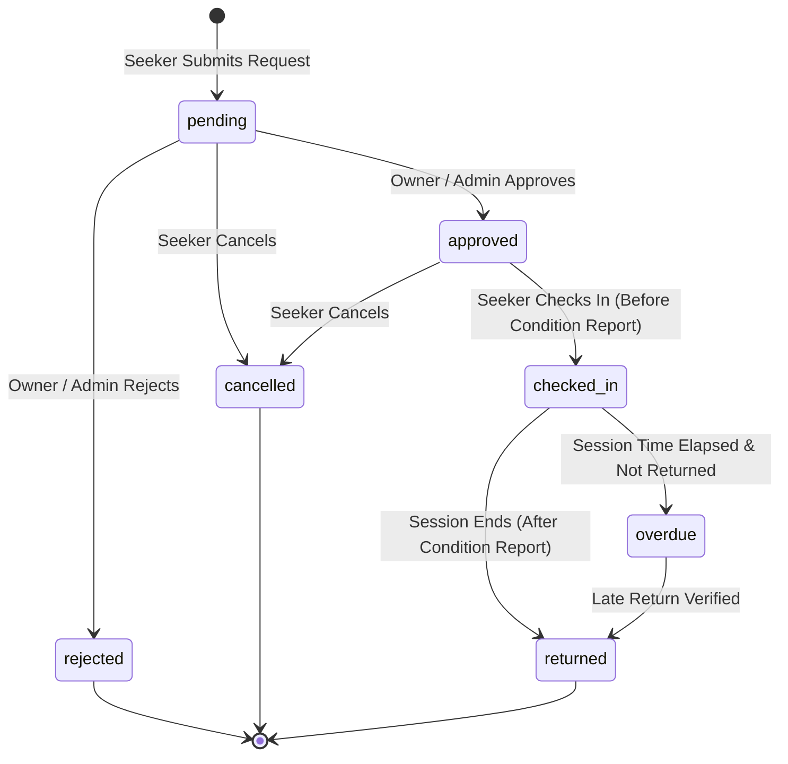

# ResourceLoop Frontend Integration & Service Layer Contract

This document provides frontend engineers with data contracts, exported backend services, query patterns, workflow state transitions, and Supabase client examples for ResourceLoop.

---

## 1. Service Layer Architecture

The backend exposes a modular service layer under `src/services/` that interacts with Supabase while enforcing data validation, Row Level Security (RLS), and business logic.

### 1.1 Resource Management Service (`src/services/resources.ts`)

```typescript
import {
  listResources,
  getResourceById,
  createResource,
  updateResource,
  deleteResource,
  getOwnerResources,
  getAvailableResources,
  uploadResourceImage,
  checkResourceEligibility,
  getResourceAvailability,
} from '../services/resources';
```

#### Function Specifications:

| Function | Parameters | Return Type | Description |
| :--- | :--- | :--- | :--- |
| **`listResources`** | `filters?: ResourceFilters` | `Promise<Resource[]>` | Search and filter resources with joins to `organization` and `owner`. |
| **`getResourceById`** | `id: string` | `Promise<Resource \| null>` | Retrieve resource details by UUID. |
| **`createResource`** | `input: CreateResourceDTO` | `Promise<Resource>` | Register new institutional asset (restricted to authorized owners/admins). |
| **`updateResource`** | `id: string, input: UpdateResourceDTO` | `Promise<Resource>` | Update resource specifications (restricted to asset owner/admin). |
| **`deleteResource`** | `id: string` | `Promise<void>` | Delete resource (restricted to asset owner/admin). |
| **`getOwnerResources`** | *none* | `Promise<Resource[]>` | Retrieve all resources managed by currently authenticated owner. |
| **`getAvailableResources`**| *none* | `Promise<Resource[]>` | Quick helper returning all resources with `status = 'available'`. |
| **`uploadResourceImage`**| `file: File, organizationId: string` | `Promise<string>` | Upload image to `resource-images` bucket and return public URL. |
| **`checkResourceEligibility`**| `resourceId: string, userId?: string` | `Promise<ResourceEligibilityResult>` | Reusable check for operational status, training, and affiliation. |
| **`getResourceAvailability`**| `resourceId: string` | `Promise<ResourceAvailabilityInfo>` | Retrieve operating days, hours, and booking slot duration. |

---

### 1.2 Profile Service (`src/services/profiles.ts`)

```typescript
import {
  getCurrentProfile,
  getProfileById,
  updateCurrentProfile,
} from '../services/profiles';
```

#### Function Specifications:

| Function | Parameters | Return Type | Description |
| :--- | :--- | :--- | :--- |
| **`getCurrentProfile`** | *none* | `Promise<Profile \| null>` | Get authenticated user's profile with linked organization. |
| **`getProfileById`** | `userId: string` | `Promise<Profile \| null>` | Lookup profile by user ID. |
| **`updateCurrentProfile`** | `input: UpdateProfileDTO` | `Promise<Profile>` | Update display name, avatar, or org. **Role escalation is blocked**. |

---

### 1.3 Organization Service (`src/services/organizations.ts`)

```typescript
import {
  getOrganizations,
  getOrganizationById,
} from '../services/organizations';
```

#### Function Specifications:

| Function | Parameters | Return Type | Description |
| :--- | :--- | :--- | :--- |
| **`getOrganizations`** | *none* | `Promise<Organization[]>` | Retrieve verified universities, research labs, and institutes. |
| **`getOrganizationById`** | `id: string` | `Promise<Organization \| null>` | Lookup organization details by UUID. |

---

## 2. Usage Examples in React Components

### 2.1 Fetching Resources with Filters (Catalogue / Discovery)

```typescript
import { useState, useEffect } from 'react';
import { listResources } from '@/services/resources';
import type { Resource, ResourceFilters } from '@/types/domain';

export function useResourceCatalogue(filters: ResourceFilters) {
  const [resources, setResources] = useState<Resource[]>([]);
  const [loading, setLoading] = useState(true);
  const [error, setError] = useState<string | null>(null);

  useEffect(() => {
    let isMounted = true;
    setLoading(true);

    listResources(filters)
      .then((data) => {
        if (isMounted) {
          setResources(data);
          setError(null);
        }
      })
      .catch((err) => {
        if (isMounted) setError(err.message);
      })
      .finally(() => {
        if (isMounted) setLoading(false);
      });

    return () => { isMounted = false; };
  }, [filters.query, filters.category, filters.resource_type, filters.available_only]);

  return { resources, loading, error };
}
```

### 2.2 Registering Equipment with Image Upload (Owner Flow)

```typescript
import { createResource, uploadResourceImage } from '@/services/resources';
import type { CreateResourceDTO } from '@/types/domain';

async function handleNewEquipmentSubmit(
  formData: CreateResourceDTO,
  imageFile: File | null
) {
  try {
    let imageUrl = formData.image_url;

    // 1. Upload image to Supabase Storage if selected
    if (imageFile) {
      imageUrl = await uploadResourceImage(imageFile, formData.organization_id);
    }

    // 2. Insert resource record
    const created = await createResource({
      ...formData,
      image_url: imageUrl,
    });

    console.log('Resource created successfully:', created.id);
    return created;
  } catch (err: any) {
    console.error('Failed to create resource:', err.message);
    throw err;
  }
}
```

### 2.3 Checking Eligibility Before Booking

```typescript
import { checkResourceEligibility } from '@/services/resources';

async function verifyBookingPrerequisites(resourceId: string) {
  const result = await checkResourceEligibility(resourceId);

  if (!result.eligible) {
    alert(`Cannot reserve: ${result.reasons.join(', ')}`);
    return false;
  }

  if (result.checks.trainingRequired) {
    // Show safety clearance confirmation dialog
    console.warn('Note: This resource requires verified training');
  }

  return true;
}
```

---

## 3. Storage Bucket: `resource-images`

ResourceLoop uses Supabase Storage for equipment and laboratory imagery.

- **Bucket Name:** `resource-images`
- **Access Level:** Public read access (`public: true`).
- **Upload Restrictions:**
  - Authenticated users with `role IN ('owner', 'admin')`.
  - Max file size: **5 MB**.
  - Permitted MIME types: `image/jpeg`, `image/png`, `image/webp`, `image/gif`, `image/svg+xml`.
- **Path Convention:** `<organization_id>/<timestamp>-<random_key>.<ext>`
- **Deletions:** Restricted to the asset uploader or platform administrators.

---

## 4. Booking Lifecycle & State Machine



### State Definitions:
1. **`pending`**: Initial state upon submission.
2. **`approved`**: Reservation confirmed by owner.
3. **`checked_in`**: Asset actively in use.
4. **`returned`**: Asset inspected and safely returned.
5. **`overdue`**: Session time elapsed without check-out.
6. **`cancelled` / `rejected`**: Terminal closed states.

---

## 5. Security & Access Control Policies

1. **Role Guard**: Normal signups are assigned `seeker`. Users cannot escalate their own role to `owner` or `admin`.
2. **Resource Ownership**: Owners can only manage resources belonging to their organization. Seekers cannot mutate resource data.
3. **Audit Trail**: All booking creation and status updates are logged immutably in `audit_logs`.
4. **RLS Verification**: Never disable RLS in client queries. Authenticated sessions rely on the Supabase JWT.
