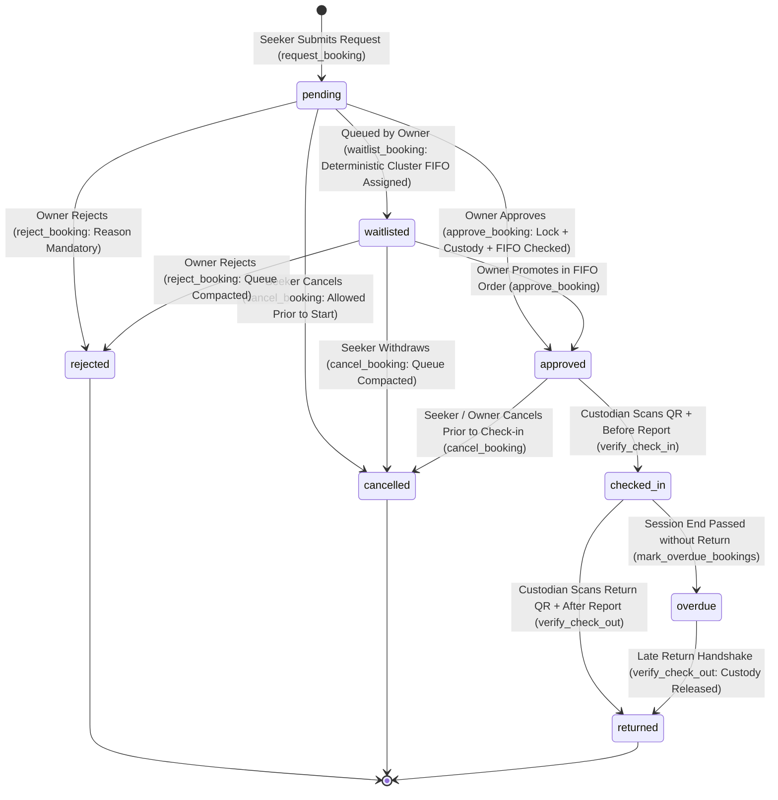

# ResourceLoop Frontend Integration & Service Layer Contract

This document provides frontend engineers with data contracts, exported backend services, query patterns, workflow state transitions, exact RPC signatures, and Supabase client integration patterns for ResourceLoop.

---

## 1. Service Layer Architecture

The backend exposes a modular service layer under `src/services/` that interacts with Supabase while enforcing data validation, Row Level Security (RLS), and business logic. Direct client mutations (`INSERT`, `UPDATE`, `DELETE`) on `public.bookings` are strictly revoked; all lifecycle changes execute via PostgreSQL `SECURITY DEFINER` RPCs.

### 1.1 Resource Management Service (`src/services/resources.ts`)

```typescript
import {
  listResources,
  getResourceById,
  createResource,
  updateResource,
  deleteResource,
  getOwnerResources,
  getAvailableResources,
  uploadResourceImage,
  checkResourceEligibility,
  getResourceAvailability,
} from '../services/resources';
```

#### Function Specifications:

| Function | Parameters | Return Type | Description |
| :--- | :--- | :--- | :--- |
| **`listResources`** | `filters?: ResourceFilters` | `Promise<Resource[]>` | Search and filter resources with joins to `organization` and `owner`. |
| **`getResourceById`** | `id: string` | `Promise<Resource \| null>` | Retrieve resource details by UUID. |
| **`createResource`** | `input: CreateResourceDTO` | `Promise<Resource>` | Register new institutional asset (restricted to authorized owners/admins). |
| **`updateResource`** | `id: string, input: UpdateResourceDTO` | `Promise<Resource>` | Update resource specifications (restricted to asset owner/admin). |
| **`deleteResource`** | `id: string` | `Promise<void>` | Delete resource (restricted to asset owner/admin). |
| **`getOwnerResources`** | `ownerId?: string` | `Promise<Resource[]>` | Retrieve all resources managed by owner (defaults to authenticated user). |
| **`getAvailableResources`**| *none* | `Promise<Resource[]>` | Quick helper returning all resources with `status = 'available'`. |
| **`uploadResourceImage`**| `file: File, organizationId: string` | `Promise<string>` | Upload image to `resource-images` bucket and return public URL. |
| **`checkResourceEligibility`**| `resourceId: string, userId?: string` | `Promise<ResourceEligibilityResult>` | Reusable check for operational status, training, and affiliation. |
| **`getResourceAvailability`**| `resourceId: string` | `Promise<ResourceAvailabilityInfo>` | Retrieve operating days, hours, and booking slot duration. |

---

### 1.2 Profile Service (`src/services/profiles.ts`)

```typescript
import {
  getCurrentProfile,
  getProfileById,
  updateCurrentProfile,
} from '../services/profiles';
```

#### Function Specifications:

| Function | Parameters | Return Type | Description |
| :--- | :--- | :--- | :--- |
| **`getCurrentProfile`** | *none* | `Promise<Profile \| null>` | Get authenticated user's profile with linked organization. |
| **`getProfileById`** | `userId: string` | `Promise<Profile \| null>` | Lookup profile by user ID. |
| **`updateCurrentProfile`** | `input: UpdateProfileDTO` | `Promise<Profile>` | Update display name, avatar, or org. **Role escalation is blocked**. |

---

### 1.3 Organization Service (`src/services/organizations.ts`)

```typescript
import {
  getOrganizations,
  getOrganizationById,
} from '../services/organizations';
```

#### Function Specifications:

| Function | Parameters | Return Type | Description |
| :--- | :--- | :--- | :--- |
| **`getOrganizations`** | *none* | `Promise<Organization[]>` | Retrieve verified universities, research labs, and institutes. |
| **`getOrganizationById`** | `id: string` | `Promise<Organization \| null>` | Lookup organization details by UUID. |

---

### 1.4 Booking & Allocation Service (`src/services/bookings.ts`)

```typescript
import {
  requestBooking,
  approveBooking,
  rejectBooking,
  waitlistBooking,
  cancelBooking,
  generateBookingPass,
  verifyCheckIn,
  verifyCheckOut,
  markOverdueBookings,
  getBookingById,
  fetchUserBookings,
  fetchOwnerBookings,
  getBookingTimeline,
  listBookings,
} from '../services/bookings';
```

#### Function Specifications:

| Function | Parameters | TypeScript Return | SQL Equivalent | Description |
| :--- | :--- | :--- | :--- | :--- |
| **`requestBooking`** | `dto: CreateBookingDTO` | `Promise<Booking>` | `public.request_booking` | **Exclusive client creation path**. Direct INSERT revoked. Atomically validates eligibility, organization status, and usage limits; inserts pending reservation. |
| **`approveBooking`** | `bookingId: string` | `Promise<Booking>` | `public.approve_booking` | Approves reservation. Acquires `resource_custody` lock. Enforces **active custody protection** (unreturned `checked_in` or `overdue` blocks new approvals) and GiST exclusion. Enforces FIFO queue order. |
| **`rejectBooking`** | `bookingId: string, rejectionReason: string` | `Promise<Booking>` | `public.reject_booking` | Rejects reservation with mandatory explanation; invalidates unused tokens and triggers waitlist recalculation. |
| **`waitlistBooking`**| `bookingId: string` | `Promise<Booking>` | `public.waitlist_booking` | Places pending reservation on the waitlist. Assigns deterministic connected-cluster position; returns updated `Booking`. |
| **`cancelBooking`** | `bookingId: string` | `Promise<Booking>` | `public.cancel_booking` | Cancels reservation prior to check-in (requester for own booking, or owner/admin); recalculates waitlist. |
| **`generateBookingPass`** | `bookingId: string, tokenType: 'check_in' \| 'check_out'` | `Promise<BookingPassResponse>` | `public.generate_booking_pass` | STRICT: Seeker only (`auth.uid() = requester_id`). Generates 256-bit cryptographically secure pass. Stores SHA-256 hash. Returns both `token` and `raw_token`. |
| **`verifyCheckIn`** | `dto: VerifyHandshakeDTO` | `Promise<Booking>` | `public.verify_check_in` | Custodian scans QR pass. Acquires `resource_custody` lock; rechecks active custody; logs pre-condition report; marks `checked_in`. |
| **`verifyCheckOut`**| `dto: VerifyHandshakeDTO` | `Promise<Booking>` | `public.verify_check_out` | Custodian scans return pass. Acquires `resource_custody` lock; logs post-condition report; auto-opens incident if damaged; marks `returned` (restores custody). |
| **`markOverdueBookings`** | *none* | `Promise<number>` | `public.mark_overdue_bookings` | Background maintenance sweep. Acquires `resource_custody` lock per asset; transitions `checked_in` past `end_time` to `overdue`. Restricted to `service_role`. |
| **`getBookingById`** | `id: string` | `Promise<Booking \| null>` | SELECT query | Retrieves booking with full joins (resource, org, profiles, condition reports, incidents). |
| **`fetchUserBookings`**| `userId?: string` | `Promise<Booking[]>` | SELECT query | Retrieves reservations requested by seeker (defaults to authenticated user). |
| **`fetchOwnerBookings`**| `ownerId?: string` | `Promise<Booking[]>` | SELECT query | Retrieves reservations for all resources managed by owner. |
| **`getBookingTimeline`**| `bookingId: string` | `Promise<{ booking, conditionReports, incidents, auditLogs }>` | Multi-table query | Complete operational history and compliance audit trail. |

---

## 2. PostgreSQL RPC Contract & Backend Specification

All booking mutations are encapsulated in PostgreSQL `SECURITY DEFINER` functions located in the `public` schema with explicit search path configuration:
```sql
SET search_path = pg_catalog, extensions, pg_temp;
```
Direct table mutations on `public.bookings` (`INSERT`, `UPDATE`, `DELETE`) are strictly `REVOKE`d from `anon` and `authenticated` roles.

### 2.1 Complete RPC Contract Matrix

| RPC Name | Parameter Names & Types | Return Type | Authorization & Grants |
| :--- | :--- | :--- | :--- |
| **`request_booking`** | `p_resource_id UUID`<br>`p_start_time TIMESTAMPTZ`<br>`p_end_time TIMESTAMPTZ`<br>`p_purpose TEXT` | `public.bookings` (ROW) | `authenticated, service_role`<br>Requester identity derived strictly from `auth.uid()`. |
| **`approve_booking`** | `p_booking_id UUID` | `public.bookings` (ROW) | `authenticated, service_role`<br>Caller must be resource owner or platform administrator (`is_admin()`). |
| **`reject_booking`** | `p_booking_id UUID`<br>`p_rejection_reason TEXT` | `public.bookings` (ROW) | `authenticated, service_role`<br>Caller must be resource owner or platform administrator (`is_admin()`). |
| **`waitlist_booking`**| `p_booking_id UUID` | `public.bookings` (ROW) | `authenticated, service_role`<br>Caller must be resource owner or platform administrator (`is_admin()`). |
| **`cancel_booking`** | `p_booking_id UUID` | `public.bookings` (ROW) | `authenticated, service_role`<br>Caller must be requester (`auth.uid() = requester_id`), owner, or admin. |
| **`generate_booking_pass`** | `p_booking_id UUID`<br>`p_token_type TEXT` | `JSONB` | `authenticated, service_role`<br>**STRICT**: Caller must be booking requester (`auth.uid() = requester_id`) or admin. |
| **`verify_check_in`** | `p_raw_token TEXT`<br>`p_condition_status TEXT`<br>`p_condition_notes TEXT DEFAULT NULL`<br>`p_image_url TEXT DEFAULT NULL` | `public.bookings` (ROW) | `authenticated, service_role`<br>Caller must be resource custodian/owner or platform administrator. |
| **`verify_check_out`**| `p_raw_token TEXT`<br>`p_condition_status TEXT`<br>`p_condition_notes TEXT DEFAULT NULL`<br>`p_image_url TEXT DEFAULT NULL` | `public.bookings` (ROW) | `authenticated, service_role`<br>Caller must be resource custodian/owner or platform administrator. |
| **`mark_overdue_bookings`** | *none* | `INTEGER` | **`service_role` ONLY**<br>`REVOKE ALL FROM PUBLIC, anon, authenticated`. Internal maintenance endpoint. |
| **`recalculate_waitlist`** | `p_resource_id UUID` | `void` | **`service_role` ONLY**<br>`REVOKE ALL FROM PUBLIC, anon, authenticated`. Internal queue engine helper. |

---

### 2.2 Reconciled Pass Generation & Handshake Return Types

#### A. Pass Generation Response (`generate_booking_pass`)
The RPC returns a single JSON object. To guarantee full frontend compatibility with both `token` and `raw_token` accessors, the response carries both fields symmetrically:

```json
{
  "booking_id": "8fa1f456-2e8b-4a52-b883-7c2299dfa991",
  "token_type": "check_in",
  "token": "4a7f29a0b38c4591e469273f5a04c107e0349a17498c8c5025f1610e20608fa8",
  "raw_token": "4a7f29a0b38c4591e469273f5a04c107e0349a17498c8c5025f1610e20608fa8",
  "expires_at": "2026-11-05T10:45:00.000Z"
}
```

- **Frontend Interface:** `BookingPassResponse` (`src/types/domain.ts`)
- **Single-Use Hashing:** Token is generated via `extensions.gen_random_bytes(32)`. Only `extensions.digest(token, 'sha256')` is persisted in `public.booking_access_tokens`. The plaintext token is never stored.

#### B. Verification Return Type (`verify_check_in` & `verify_check_out`)
Both verification endpoints return the complete updated `public.bookings` row (`RETURNS public.bookings`), matching the frontend TypeScript `Promise<Booking>`.

- **Frontend Parameter Alignment:** The frontend DTO `VerifyHandshakeDTO` parameters map 1:1 to the PostgreSQL RPC arguments:
  ```typescript
  // Frontend invocation in src/services/bookings.ts
  const { data, error } = await supabase.rpc('verify_check_in', {
    p_raw_token: dto.raw_token.trim(),
    p_condition_status: dto.condition_status,
    p_condition_notes: dto.condition_notes?.trim() || null,
    p_image_url: dto.image_url?.trim() || null,
  });
  ```
- **Returned Row Fields:**
  `id`, `resource_id`, `requester_id`, `start_time`, `end_time`, `purpose`, `status`, `approved_by`, `rejection_reason`, `waitlist_position`, `created_at`, `updated_at`.
- **UI State Benefit:** Eliminates secondary queries—the caller receives the updated `Booking` model in the RPC response and immediately synchronizes local React state.

---

## 3. Active Custody Protection & Concurrency Architecture

### 3.1 Unreturned Asset Approval Lockout Invariant
ResourceLoop enforces strict **active physical custody protection**:
> **Invariant:** If a resource currently has ANY unreturned booking in `checked_in` or `overdue` status, **ALL new reservation approvals for that resource are blocked** until physical return and inspection are completed via `verify_check_out()`.

- **Elapsed Time Does Not Grant Release:** Even if an ongoing session's scheduled `end_time` has elapsed, physical possession remains with the borrower until `verify_check_out` executes.
- **Enforcement Implementation:**
  Inside `public.approve_booking()`:
  ```sql
  -- Acquire shared resource custody lock
  PERFORM pg_advisory_xact_lock(hashtext('resource_custody:' || v_booking.resource_id::text));

  -- Active custody lockout check
  IF EXISTS (
      SELECT 1 FROM public.bookings
      WHERE resource_id = v_booking.resource_id
        AND id <> v_booking.id
        AND status IN ('checked_in', 'overdue')
  ) THEN
      RAISE EXCEPTION 'Active custody conflict: Equipment is currently in active possession of another borrower (status: checked_in or overdue). New reservations cannot be approved until physical checkout and return inspection are completed.'
      USING ERRCODE = 'P0001';
  END IF;
  ```

### 3.2 Strict Lock Hierarchy & Deadlock Prevention
To eliminate race conditions and deadlock hazards between concurrent handshakes, approvals, and automated background jobs, all custody-altering procedures strictly enforce a **two-step global lock acquisition hierarchy**:

1. **Step 1: Coarse-Grained Advisory Lock (`pg_advisory_xact_lock`)**
   Every mutation function operating on a resource must FIRST acquire the transaction-level advisory lock on that resource before acquiring any row locks:
   ```sql
   PERFORM pg_advisory_xact_lock(hashtext('resource_custody:' || resource_id::text));
   ```
2. **Step 2: Fine-Grained Row Locks (`FOR UPDATE`)**
   Row locks on `public.bookings` and `public.booking_access_tokens` are strictly acquired *under* the custody advisory lock.
3. **Deterministic Multi-Resource Iteration in Batch Sweeps:**
   In `mark_overdue_bookings()`, the sweep groups overdue records by resource and orders them deterministically (`ORDER BY resource_id`), acquiring the advisory lock for each resource prior to locking its booking rows (`ORDER BY b.id FOR UPDATE OF b`).

#### Deadlock Risk Analysis:
- **No Inverted Lock Orders:** Because the advisory lock is the coarse-grained gatekeeper and is always acquired before any row lock, no transaction can hold a row lock on a resource's booking while waiting for another transaction's advisory lock.
- **Single-Resource Serialization:** Concurrent calls to `approve_booking`, `verify_check_in`, `verify_check_out`, and `mark_overdue_bookings` for the same asset serialize at the advisory lock level, mathematically eliminating circular wait conditions.
- **Cross-Resource Safety:** Multi-resource background sweeps lock distinct resources in ascending `resource_id` order, preventing cross-resource circular wait cycles.

---

## 4. Waitlist Queue Semantics & Chained Overlaps

### 4.1 Connected Interval Cluster Semantics
In real laboratory environments, reservations often involve non-identical, partially overlapping, or chained time windows. ResourceLoop structures the waitlist queue through **Connected Interval Clusters**:

1. **Connected Component Grouping:**
   Two waitlisted requests belong to the same cluster if their time windows directly overlap (`tstzrange && tstzrange`) OR if they are connected through an unbroken chain of overlapping waitlisted intervals (e.g. Request A overlaps B, and B overlaps C).
2. **Deterministic FIFO Ranking:**
   Within each connected cluster for a resource, waitlisted requests are ranked strictly sequentially (`waitlist_position = 1, 2, 3...`) ordered by `(created_at ASC, id ASC)`.
3. **Cluster Independence:**
   Non-overlapping intervals (e.g. Monday 10:00-12:00 vs Friday 14:00-16:00) form distinct, independent clusters. Each cluster maintains its own independent queue starting at position 1.
4. **Compaction on Cancellation:**
   When an approved or waitlisted booking is cancelled or rejected, `public.recalculate_waitlist(resource_id)` dynamically re-evaluates the connected clusters and compacts remaining requests sequentially without gaps.

### 4.2 Strict FIFO Enforcement on Approval
To maintain fairness and prevent queue jumping, `approve_booking` enforces strictly deterministic connected-cluster queue order:
- **Waitlisted Approval Rule:** An owner or administrator **cannot approve** a waitlisted booking if there exists another earlier-submitted waitlisted booking in the same connected-overlap cluster (i.e. `v_booking.waitlist_position > 1`). In an A-B-C chained interval (where A overlaps B, and B overlaps C), Candidate C cannot bypass Candidate A or B; only the candidate holding position 1 in that connected cluster can be approved.
- **Pending Approval Rule:** An owner **cannot approve** a newly submitted `pending` booking if an earlier `waitlisted` cluster exists whose connected interval span intersects with the candidate request.
- **Violation Outcome:** Throws exception with code `P0001` (`FIFO fairness violation: Earlier waitlisted request exists for this connected cluster. Waitlisted requests must be approved in FIFO order.`).

---

## 5. Booking Lifecycle & State Machine



---

## 6. Security & Extension Configuration

### 6.1 Extension Schema Placement (`extensions`)
- Supabase hosts cryptographic and indexing extensions in the dedicated `extensions` schema.
- Migration `004_booking_engine.sql` ensures `extensions` exists and installs:
  ```sql
  CREATE EXTENSION IF NOT EXISTS btree_gist WITH SCHEMA extensions;
  CREATE EXTENSION IF NOT EXISTS pgcrypto WITH SCHEMA extensions;
  ```
- If `pgcrypto` or `btree_gist` was previously installed into `public` by legacy migrations, Migration 004 automatically relocates them to `extensions` via `ALTER EXTENSION ... SET SCHEMA extensions;`.
- Extension functions (`digest`, `gen_random_bytes`, `encode`) resolve safely across all RPCs under `SET search_path = pg_catalog, extensions, pg_temp;`.

---

## 7. Stage 3 Verification Suite & Test Status

The test suite in `supabase/tests/booking_engine_verification.sql` specifies automated pgTAP / PLpgSQL transaction blocks for all 9 backend engine requirements against isolated fixture scenarios.

> [!IMPORTANT]
> **Execution Status Disclosure:** In compliance with explicit project policy, Migration 004 has **NOT** been executed against the live Supabase project, and no local disposable PostgreSQL instance is installed on the host environment. Therefore, these tests are **Authored and Validated by Static Code and Schema Logic Analysis**, awaiting live database execution in a staging environment prior to production migration.

| Test ID | Requirement Tested | Expected Invariant | Status |
| :--- | :--- | :--- | :--- |
| **TEST 1** | Scheduled Overlap Exclusion | GiST exclusion constraint blocks overlapping approved intervals on the same resource (`SQLSTATE 23P01`). | Authored & Logic Verified |
| **TEST 2** | Active Custody Protection | An unreturned `checked_in` or `overdue` booking strictly blocks new approvals even if scheduled end time has passed (`SQLSTATE P0001`). | Authored & Logic Verified |
| **TEST 3** | Shared Custody Lock & Check-in Recheck | Serializes concurrent check-in requests via `resource_custody` advisory lock; rechecks under lock to prevent double-custody. | Authored & Logic Verified |
| **TEST 4** | Direct Table Mutation Lockdown | Direct client `INSERT`, `UPDATE`, `DELETE` on `public.bookings` is strictly revoked from `anon` and `authenticated`. | Authored & Logic Verified |
| **TEST 5** | Seeker-Only QR Pass Generation | Only the booking's seeker can generate passes; returns `{ booking_id, token_type, token, raw_token, expires_at }`; stores only SHA-256 hash. | Authored & Logic Verified |
| **TEST 6** | Single-Use Replay Attack Prevention | Access tokens record `used_at = now()`. Re-scan attempts are rejected immediately. | Authored & Logic Verified |
| **TEST 7** | Chained Interval FIFO Queue & Compaction | Chained overlapping intervals (A $\leftrightarrow$ B $\leftrightarrow$ C) receive sequential positions 1, 2, 3; independent interval D retains position 1; cancellation triggers seamless compaction. | Authored & Logic Verified |
| **TEST 8** | FIFO Enforcement on Approval | Attempting to approve an overlapping waitlisted candidate out of FIFO order throws `FIFO fairness violation` (`SQLSTATE P0001`). | Authored & Logic Verified |
| **TEST 9** | Return Verification & Incident Escalation | Return handshake releases custody; damaged return automatically opens incident and records immutable audit log. `mark_overdue_bookings` acquires shared custody lock. | Authored & Logic Verified |
