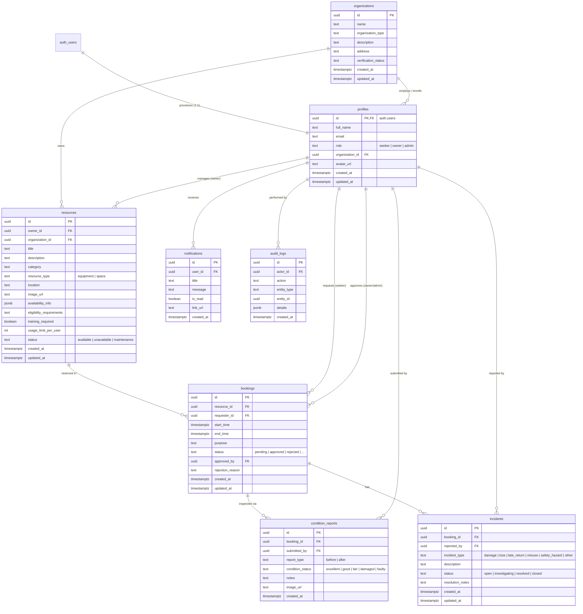

# ResourceLoop Database Architecture

ResourceLoop is an institutional resource sharing network connecting universities, research laboratories, and institutes. This document specifies the PostgreSQL database schema, data relationships, Row Level Security (RLS) policies, and database automation triggers designed for Supabase.

---

## 1. Entity-Relationship Diagram (ERD)

---

## 2. Table Specifications

### 2.1 `organizations`
Represents participating academic and research institutions.
* **`id`** (`UUID`, PK, `gen_random_uuid()`): Unique identifier.
* **`name`** (`TEXT`, NOT NULL): Full legal/institutional name.
* **`organization_type`** (`TEXT`, NOT NULL): Allowed: `'university'`, `'research_lab'`, `'institute'`, `'department'`, `'other'`.
* **`description`** (`TEXT`): Research scope, department details.
* **`address`** (`TEXT`): Campus address / geographical location.
* **`verification_status`** (`TEXT`, NOT NULL, default `'pending'`): Allowed: `'pending'`, `'verified'`, `'rejected'`.
* **`created_at` / `updated_at`** (`TIMESTAMPTZ`, default `now()`).

### 2.2 `profiles`
User profiles synced with Supabase `auth.users`.
* **`id`** (`UUID`, PK, `REFERENCES auth.users(id) ON DELETE CASCADE`): Unique user ID.
* **`full_name`** (`TEXT`, NOT NULL): Display name.
* **`email`** (`TEXT`, NOT NULL): Institutional email.
* **`role`** (`TEXT`, NOT NULL, default `'seeker'`): Allowed: `'seeker'`, `'owner'`, `'admin'`.
* **`organization_id`** (`UUID`, `REFERENCES organizations(id) ON DELETE SET NULL`): Affiliated institution.
* **`avatar_url`** (`TEXT`): URL to profile image.
* **`created_at` / `updated_at`** (`TIMESTAMPTZ`, default `now()`).

### 2.3 `resources`
Physical institutional assets (laboratories, cleanrooms, spectrometers, CNCs).
* **`id`** (`UUID`, PK, `gen_random_uuid()`).
* **`owner_id`** (`UUID`, `REFERENCES profiles(id) ON DELETE RESTRICT`): Custodian/manager responsible for approvals.
* **`organization_id`** (`UUID`, `REFERENCES organizations(id) ON DELETE CASCADE`): Institution hosting the resource.
* **`title`** (`TEXT`, NOT NULL): Resource name.
* **`description`** (`TEXT`): Specifications, operating guidelines.
* **`category`** (`TEXT`, NOT NULL): E.g., `Microscopy & Imaging`, `Cleanroom & Fabrication`.
* **`resource_type`** (`TEXT`, NOT NULL): Allowed: `'equipment'`, `'space'`.
* **`location`** (`TEXT`, NOT NULL): Room/building coordinates.
* **`image_url`** (`TEXT`): Asset image.
* **`availability_info`** (`JSONB`, NOT NULL): Operating schedule and slot duration configuration.
* **`eligibility_requirements`** (`TEXT`): Safety clearances or prerequisite courses.
* **`training_required`** (`BOOLEAN`, NOT NULL, default `false`).
* **`usage_limit_per_user`** (`INTEGER`, NOT NULL, default `1`).
* **`status`** (`TEXT`, NOT NULL, default `'available'`): Allowed: `'available'`, `'unavailable'`, `'maintenance'`.
* **`created_at` / `updated_at`** (`TIMESTAMPTZ`, default `now()`).

### 2.4 `bookings`
Reservation requests and session bookings.
* **`id`** (`UUID`, PK, `gen_random_uuid()`).
* **`resource_id`** (`UUID`, `REFERENCES resources(id) ON DELETE CASCADE`).
* **`requester_id`** (`UUID`, `REFERENCES profiles(id) ON DELETE CASCADE`).
* **`start_time` / `end_time`** (`TIMESTAMPTZ`, NOT NULL): Enforces `end_time > start_time`.
* **`purpose`** (`TEXT`, NOT NULL): Project description.
* **`status`** (`TEXT`, NOT NULL, default `'pending'`): Allowed: `'pending'`, `'approved'`, `'rejected'`, `'waitlisted'`, `'checked_in'`, `'returned'`, `'cancelled'`, `'overdue'`.
* **`approved_by`** (`UUID`, `REFERENCES profiles(id) ON DELETE SET NULL`).
* **`rejection_reason`** (`TEXT`).
* **`waitlist_position`** (`INTEGER`, default `NULL`): Deterministic FIFO queue position per resource.
* **`created_at` / `updated_at`** (`TIMESTAMPTZ`, default `now()`).
* **Exclusion Constraint**: `no_overlapping_scheduled_bookings` (`EXCLUDE USING gist (resource_id WITH =, tstzrange(start_time, end_time, '[)') WITH &&) WHERE (status IN ('approved', 'checked_in'))`) prevents concurrent double-booking at the PostgreSQL engine level.

### 2.5 `booking_access_tokens`
Opaque, high-entropy QR access tokens for single-use physical check-in and return handshakes.
* **`id`** (`UUID`, PK, `gen_random_uuid()`).
* **`booking_id`** (`UUID`, `REFERENCES bookings(id) ON DELETE CASCADE`).
* **`token_type`** (`TEXT`, NOT NULL): Allowed: `'check_in'`, `'check_out'`.
* **`token_hash`** (`TEXT`, NOT NULL, UNIQUE): SHA-256 hash of the 256-bit opaque random token.
* **`expires_at`** (`TIMESTAMPTZ`, NOT NULL).
* **`used_at`** (`TIMESTAMPTZ`, default `NULL`): Single-use timestamp preventing replay attacks.
* **`created_at`** (`TIMESTAMPTZ`, default `now()`).
* **Security**: RLS strictly blocks ordinary user `SELECT` access. Validated exclusively via `SECURITY DEFINER` RPCs.

### 2.6 `condition_reports`
Inspection audit records taken prior to starting usage and upon returning equipment.
* **`id`** (`UUID`, PK, `gen_random_uuid()`).
* **`booking_id`** (`UUID`, `REFERENCES bookings(id) ON DELETE CASCADE`).
* **`submitted_by`** (`UUID`, `REFERENCES profiles(id) ON DELETE CASCADE`).
* **`report_type`** (`TEXT`, NOT NULL): Allowed: `'before'`, `'after'`.
* **`condition_status`** (`TEXT`, NOT NULL): Allowed: `'excellent'`, `'good'`, `'fair'`, `'damaged'`, `'faulty'`.
* **`notes`** (`TEXT`).
* **`image_url`** (`TEXT`).
* **`created_at`** (`TIMESTAMPTZ`, default `now()`).
* **Constraint**: `UNIQUE(booking_id, report_type)` prevents duplicate submissions per stage.

### 2.6 `incidents`
Safety hazards, physical damage, late returns, or equipment misuse.
* **`id`** (`UUID`, PK, `gen_random_uuid()`).
* **`booking_id`** (`UUID`, `REFERENCES bookings(id) ON DELETE SET NULL`).
* **`reported_by`** (`UUID`, `REFERENCES profiles(id) ON DELETE CASCADE`).
* **`incident_type`** (`TEXT`, NOT NULL): Allowed: `'damage'`, `'loss'`, `'late_return'`, `'misuse'`, `'safety_hazard'`, `'other'`.
* **`description`** (`TEXT`, NOT NULL).
* **`status`** (`TEXT`, NOT NULL, default `'open'`): Allowed: `'open'`, `'investigating'`, `'resolved'`, `'closed'`.
* **`resolution_notes`** (`TEXT`).
* **`created_at` / `updated_at`** (`TIMESTAMPTZ`, default `now()`).

### 2.7 `notifications`
Real-time user alerts.
* **`id`** (`UUID`, PK, `gen_random_uuid()`).
* **`user_id`** (`UUID`, `REFERENCES profiles(id) ON DELETE CASCADE`).
* **`title`** (`TEXT`, NOT NULL).
* **`message`** (`TEXT`, NOT NULL).
* **`is_read`** (`BOOLEAN`, NOT NULL, default `false`).
* **`link_url`** (`TEXT`).
* **`created_at`** (`TIMESTAMPTZ`, default `now()`).

### 2.8 `audit_logs`
Immutable compliance log.
* **`id`** (`UUID`, PK, `gen_random_uuid()`).
* **`actor_id`** (`UUID`, `REFERENCES profiles(id) ON DELETE SET NULL`).
* **`action`** (`TEXT`, NOT NULL).
* **`entity_type`** (`TEXT`, NOT NULL).
* **`entity_id`** (`UUID`).
* **`details`** (`JSONB`, default `'{}'::jsonb`).
* **`created_at`** (`TIMESTAMPTZ`, default `now()`).

---

## 3. Row Level Security (RLS) Strategy

Row Level Security is enabled across all 8 tables.

| Table | SELECT | INSERT | UPDATE | DELETE |
| :--- | :--- | :--- | :--- | :--- |
| `organizations` | Verified or user's org | Admin only | Admin only | Admin only |
| `profiles` | Own profile, org peers, owners, admins | Own profile / trigger | Own profile (role immutable) | Admin only |
| `resources` | Active resources (`status <> 'unavailable'`) or owner/admin | Owner/Admin with matching org | Owner or Admin | Owner or Admin |
| `bookings` | Requester, Resource Owner, or Admin | **RPC ONLY** (`request_booking`) | **RPC ONLY** (Designated state transitions) | Admin only |
| `booking_access_tokens` | Admin only | System / RPC | Admin only | Admin only |
| `condition_reports` | Requester, Owner, Admin | Booking participants | **BLOCKED** (Immutable) | Admin only |
| `incidents` | Reporter, Owner, Admin | Booking participants | Owner or Admin | Admin only |
| `notifications` | Recipient only (`user_id = auth.uid()`) | System / Authenticated | Recipient only (`is_read`) | Recipient only |
| `audit_logs` | Admin only | Authenticated / Triggers | **BLOCKED** (Immutable) | **BLOCKED** (Immutable) |

### Privilege Escalation & RPC-Only State Machine Guarding
1. **Direct Table Privilege Revocation**: Direct `INSERT`, `UPDATE`, and `DELETE` on `public.bookings` are strictly **REVOKED** from `authenticated` and `anon` roles. All booking creation and state transitions must execute through designated `SECURITY DEFINER` RPCs.
2. **Search Path Hardening**: All RPCs configure `SET search_path = pg_catalog, extensions, pg_temp`, removing `public` from the search path to eliminate object-hijacking vectors. All application objects are explicitly schema-qualified (`public.*`).
3. **User Role Escalation**: Profile role changes are blocked unless caller is `is_admin()`.

---

## 4. Database Triggers & Automation

1. **`trg_organizations_updated_at` / `trg_profiles_updated_at` / `trg_resources_updated_at` / `trg_bookings_updated_at` / `trg_incidents_updated_at`**:
   Automatically refreshes `updated_at` timestamps on row mutation.
2. **`on_auth_user_created`**:
   Automatically provisions a new record in `public.profiles` whenever an identity is registered in `auth.users`.
3. **`trg_profiles_role_guard`**:
   Prevents non-administrators from escalating their role.
4. **`trg_booking_state_machine_guard`**:
   Guarantees direct client mutations cannot bypass the booking RPC state machine.
5. **`trg_booking_lifecycle`**:
   - On `INSERT`: Notifies the resource owner of a pending reservation request and writes a `BOOKING_CREATED` audit log entry.
   - On `UPDATE`: When `status` changes, notifies the requester (e.g., `Booking Approved`) and writes a `BOOKING_STATUS_<STATUS>` audit log entry.

---

## 5. Deployment Instructions

1. Open your Supabase Dashboard at [https://supabase.com/dashboard](https://supabase.com/dashboard).
2. Navigate to **SQL Editor**.
3. Copy the contents of [`supabase/migrations/001_initial_schema.sql`](file:///Users/vinayak_sharma/Desktop/ResourceLoop/supabase/migrations/001_initial_schema.sql) and paste into a new query. Click **Run**.
4. (Optional for development) Run [`supabase/seed.sql`](file:///Users/vinayak_sharma/Desktop/ResourceLoop/supabase/seed.sql) to populate realistic demonstration data.
5. In **Authentication > URL Configuration**, verify your site URL matches your development frontend (`http://localhost:5173`).
